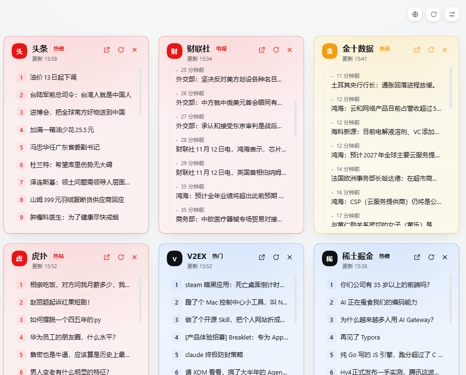
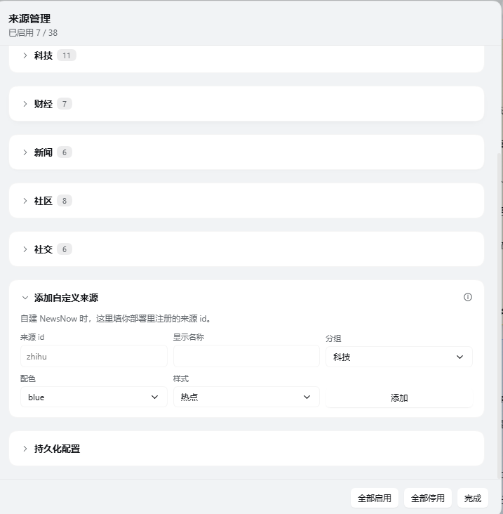

# dsh-plugin-newsnow

把 [NewsNow](https://github.com/newsnext/newsnow) 的热榜接进 [DeepSeek Harness](https://github.com/deepseek-ai/deepseek-harness)：NewsNow 风格的卡片墙面板、来源管理、内嵌浏览器分栏，外加一个智能体工具。数据来自 NewsNow 的 `GET <baseUrl>/api/s?id=<id>`，插件不抓取任何页面。



**特性**

- 侧边栏入口 + 中央面板 + 会话页头条胶囊，浅色 / 深色主题跟随应用
- 38 个内置热榜来源，支持自定义来源（分组 / 颜色 / 类型）
- 智能体工具 `newsnow_news`（`source?` / `limit` / `force?`）
- 链接打开方式三选一：内嵌浏览器分栏（Desktop）/ 侧边栏浏览器（Web）/ 系统浏览器
- 自动刷新（关闭 / 1 / 5 / 15 / 30 分钟）、懒加载、并发队列、失败回退旧数据
- 界面文案跟随 Harness 的八种界面语言（zh / en / ja / es / fr / de / ru / pt）
- 面板切换不丢状态（滚动位置、页签、弹窗、折叠状态均跨面板记忆；开合内嵌分栏、拖宽后仍锚定正在阅读的卡片）
- 卡片可拖拽排序，顺序持久保存（会话页头条跟随排序后的第一个来源）

## 安装

```bash
git clone https://github.com/<you>/dsh-plugin-newsnow.git
dsh plugin install ./dsh-plugin-newsnow
```

## 配置

| 字段 | 类型 | 默认 | 说明 |
| --- | --- | --- | --- |
| `baseUrl` | string | `https://newsnow.busiyi.world` | NewsNow 部署地址（可指向自建实例） |
| `sources` | string[] | 38 个内置来源 | 启用的来源与卡片顺序 |
| `disabledSources` | string[] | `[]` | 显式停用的来源 id |
| `customSources` | object[] | `[]` | 自定义来源 |
| `refreshSeconds` | 30–3600 | `300` | Host 缓存有效期 |
| `requestTimeoutMs` | 1000–60000 | `12000` | 单次上游请求超时 |
| `userAgent` | string | `Mozilla/5.0 (compatible; dsh-newsnow/1.0)` | 上游要求浏览器 UA，否则 403 |

界面上的开关与偏好会持久化到 `<DSH_HOME|~/.dsh>/storages/dsh-newsnow.json`，删除该文件即恢复配置默认；卡片排序与内嵌页签记录存在浏览器 localStorage（`dsh-newsnow:card-order` / `dsh-newsnow:embed-tabs`），上游数据只在内存缓存、不落盘。

## 来源管理

「管理来源」弹窗（720px，遮罩点击关闭，全部启用 / 全部停用 / 完成固定右下角）：来源按分组拆成可折叠子卡片，带源色圆点的 chip 开关立即生效且只做局部更新；「自动刷新」「链接打开方式」「添加自定义来源」「持久化配置」各为独立折叠卡片。



**添加自定义来源**：填 NewsNow 的 source id——见 GitHub 仓库 `newsnext/newsnow` 的 `server/sources` 目录，可先在浏览器验证 `https://newsnow.busiyi.world/api/s?id=<id>` 是否可用。字段 `{ id, name?, group?, color?, type?, title?, home? }`：`id` 必填（`[a-z0-9._:-]`，≤120，不能与内置重名）；`group` ∈ `tech|finance|news|community|social`；`type` ∈ `hottest|realtime`。

内置 38 个来源均对公共部署实测可用。注意：`36kr` 系 id 不可用；GitHub 热榜 id 是 `github` 而非 `github-trending`。

## 已知限制

- 内嵌浏览器依赖 Desktop 壳（`globalThis.dshDesktop`），仅 Desktop 可用；Web 端选「内嵌」时自动降级为侧边栏链路，侧边栏浏览器在 Web 端默认禁用（需在 profile 补丁启用 `ui-sidebar-browser`）。
- 公共部署有速率与可用性风险，需要稳定时自建 NewsNow 并把 `baseUrl` 指过去。

架构、约束与开发约定见 [AGENTS.md](AGENTS.md)。

## 致谢

- [newsnext/newsnow](https://github.com/newsnext/newsnow) —— 热榜聚合与数据来源。

[](https://github.com/deepseek-ai/deepseek-harness)
